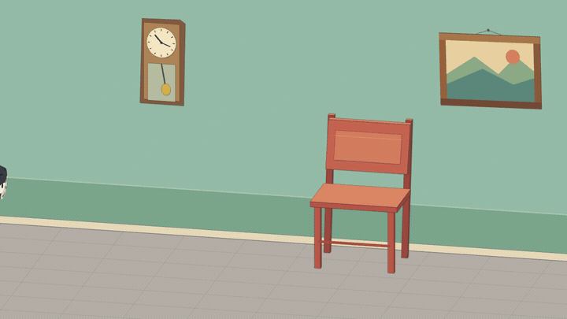

# Curio Motion

**Editable 2D animation authored in TypeScript.** PixiJS draws vector contours; Remotion owns composition, live Player, frame time and official MP4 export.

**[0.2.0-beta.1](https://github.com/vvvivaldy/curio-motion/releases/tag/v0.2.0-beta.1) is a source-project beta.** Download the verified ZIP and checksum from the prerelease, or clone this repository. It remains a local editable project with `private: true`, not an npm package. [Beta scope](BETA.md) · [Verification](docs/BETA_0_2_0_VERIFICATION_RU.md) · [Русский](README_RU.md)

## Start locally

Use **Node ≥22.12**, npm and a WebGL-capable browser. Unpack the release ZIP or clone the repository, then run in its root:

```sh
npm ci
npm run check
npm run demo:raccoon
```

Use the address printed by Vite, normally `http://127.0.0.1:4176/player.html?example=raccoon-courier`. Click play to hear audio. `npm run dev` starts the server without opening a page; an occupied port can change the printed address.

| Try | Live code-rendered Player | Official composition |
| --- | --- | --- |
| Raccoon: envelope, grips and recorded sound | `/player.html?example=raccoon-courier` | `RaccoonCourier` |
| Educational delivery infographic | `/player.html?example=delivery-infographic` | `DeliveryInfographic` |
| Amber robot: watering-can interaction | `/player.html?example=amber-robot` | `AmberRobot` |
| Paper cat: 35-second story and sound | `/player.html?example=cat-picture-story-v3` | `CatPictureStoryV3` |
| Black cat: chair climb and landing | `/player.html?example=black-cat-chair` | `BlackCatChair` |
| Pink monkey: preserved first scene | `/player.html?example=pink-monkey` | `PinkMonkey` |

`/viewer.html?example=…` shows a preserved exported movie/reference/source where available; `/index.html?example=…` draws the direct Pixi baseline. Private authoring inputs are absent from the archive and are not needed to run the included scenes.

Install **Chrome/Chromium separately** for export. No browser is downloaded automatically. If detection fails, point `CHROME_PATH` at its executable:

```sh
# macOS/Linux; replace with your actual installed executable
export CHROME_PATH="/path/to/installed/chrome"
COMPOSITION_ID=RaccoonCourier RENDER_AUDIO_CODEC=aac npm run render
COMPOSITION_ID=DeliveryInfographic npm run render
```

Outputs: `outputs/raccoon-courier-remotion.mp4` and `outputs/delivery-infographic-remotion.mp4`. Plain `npm run render` exports the default monkey. [PowerShell, commands and troubleshooting](docs/DEVELOPMENT.md).

No runtime account, AI API key or hosted generator is required. `npm ci` needs npm registry access. Browser preview/export has been exercised on **macOS**; Windows/Linux browser rendering is unverified. Linux type/test/build CI is a separate check. Main MP4 export uses Remotion's installed encoder; optional GIF/baseline/review tools may require system FFmpeg.

## Examples and source

[](docs/assets/cat-picture-story-v3.mp4)

[Paper cat film](docs/assets/cat-picture-story-v3.mp4) · [run/export notes](docs/CAT_PICTURE_STORY.md). The GIF derives from the official film; live frames are drawn from code.

| Source | What it demonstrates |
| --- | --- |
| [Raccoon courier](src/examples/raccoon-courier) | Supported regrips, bounded arms, bag containment and event-based recorded effects; [film](docs/assets/raccoon-courier-anatomy-sound-v3.mp4) |
| [Delivery infographic](src/examples/delivery-infographic) | Three explicit **synthetic** values in `data.ts`, derived totals/percentages, one scale; [film](docs/assets/delivery-infographic-first-pass.mp4) |
| [Amber robot](src/examples/amber-robot) | Different proportions, held-prop anchors and a shared scene bridge; [film](docs/assets/amber-robot-v2.mp4) |
| [Black cat](src/examples/black-cat-chair) | Chair grips, climb, sit, turn, four-limb landing; [film](docs/assets/black-cat-chair-v3.mp4) |
| [Pink monkey](src/examples/pink-monkey) | Walk, turn, stair support and a finite gesture; [film](docs/assets/demo-v5.mp4) |
| [Boar A/B](docs/reviews/boar-ab/README.md) | Preserved before/after review of one known task, including failed observations and repairs |

These are authored examples, not an arbitrary-reference generation benchmark. The author interprets the whole reference and writes geometry, anatomy, staging and timing. Shared helpers make that work editable; numerical checks cannot approve artistic quality or sound.

## Work with an agent

Open the project folder in a coding agent. It should read [AGENTS.md](AGENTS.md), [the local authoring skill](.agents/skills/curio-authoring/SKILL.md) and your whole reference/action. No previous chat is required. [Practical user/team guidance in Russian](docs/USAGE_RU.md) includes setup, copyable author/critic tasks and the recommended small team: an author plus a human, with an independent critic for complex interactions and a mathematician only for a concrete geometry problem.

Use `npm run create:example -- …` to prepare a blank typed scene, whole input copy, unchanged action and review plan. It does not draw, infer anatomy or register the scene automatically. The generated instructions list the required registry edits. Start with held control drawings, then blocking, transitions, sound and actual encoded-film review. Preserve the original version when repairing a defect.

## Use the local API

In a browser TypeScript module in this checkout:

```ts
import { createPixiStage } from './src/core/stage';
import { amberRobotScene } from './src/examples/amber-robot/scene';

const host = document.createElement('div');
document.body.append(host);
const stage = await createPixiStage(host, amberRobotScene);
stage.draw(120); // 4 seconds at 30 fps
stage.draw(0);   // backward seek, without accumulated state
stage.destroy();
```

The local [typed API](docs/API.md) includes scenes/time, coordinates, contours, contacts, gait, run and constrained-limb helpers. Scene anatomy/style remain in `src/examples/`. Automatic recognition, a universal rig, an action-language parser, hosted rendering and physics simulation are not implemented.

## Documentation and status

| Read | Purpose |
| --- | --- |
| [Development](docs/DEVELOPMENT.md) | Installation, Chrome, live pages, official exports and troubleshooting |
| [User guide](docs/USAGE_RU.md) / [agent entry](AGENT_START_HERE_RU.md) | Practical task setup, roles and short prompts |
| [API](docs/API.md) / [architecture](docs/ARCHITECTURE.md) | Current contracts and implementation boundaries |
| [Authoring](docs/AUTHORING.md) / [local skill](.agents/skills/curio-authoring/SKILL.md) | Scaffold, control drawings, staged evidence and honest review |
| [Sound catalog](docs/SFX_CATALOG_RU.md) | Effects by material/action, variants, sources and licenses |
| [Beta conditions](BETA.md) / [roadmap](docs/ROADMAP.md) | Current beta, limitations and beta → 1.0 gates |
| [Verification history](docs/VERIFICATION.md) | Historical checks of their specific source/film versions |

The beta ships as source, not a separately installable library package. Archive verification is separate from acceptance of an example film. The attached ZIP is the exact clean-tested payload; the Git tag adds publication documentation and its own updated manifest without changing rendering inputs. Review actual rendered frames, continuity and audio; report what was really inspected. For a complete packaged archive, `npm run verify:package` checks its manifest before edits; it will intentionally fail after payload changes until repackaged.

## Contributing and rights

[Contributing](CONTRIBUTING.md) · [report a reproducible bug](https://github.com/vvvivaldy/curio-motion/issues/new?template=bug.yml) · [security](SECURITY.md).

Original project code is [MIT](LICENSE). Artwork/audio and Remotion have separate terms: [ASSETS](ASSETS.md), [THIRD_PARTY_NOTICES](THIRD_PARTY_NOTICES.md), [Remotion license](docs/licenses/REMOTION-LICENSE.md). Keep required source attributions with derived media; the code license does not relicense dependencies or all assets.
