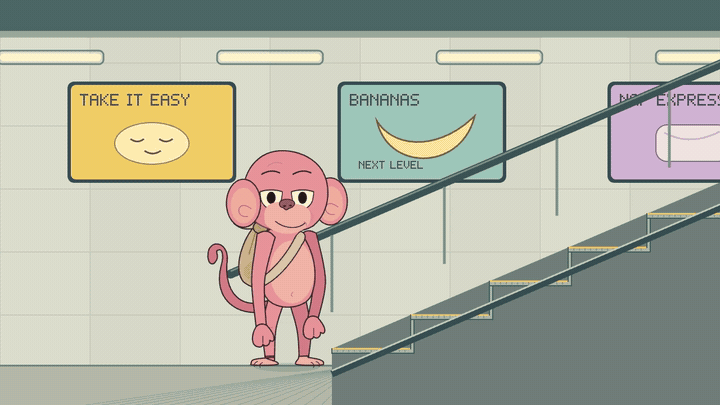
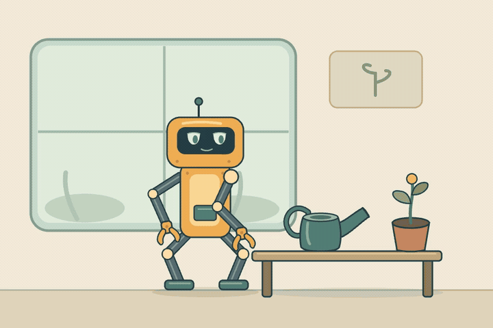
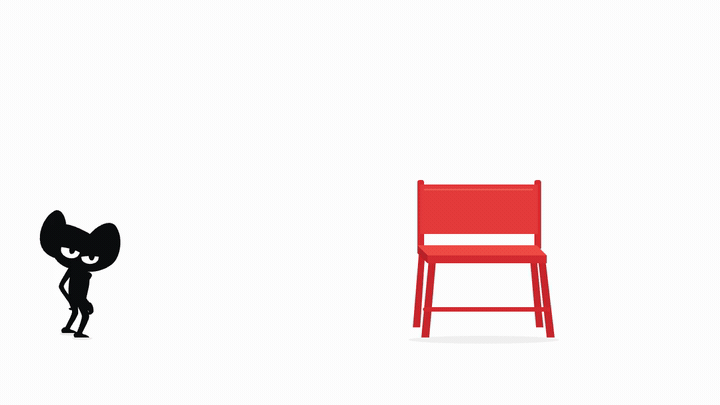

# Curio Motion

**Code-authored 2D animation with PixiJS and Remotion.** Draw characters as TypeScript contours, author their motion, and export a film you can inspect frame by frame.

[](https://github.com/vvvivaldy/curio-motion/actions/workflows/ci.yml) [](LICENSE) [](#project-status) [](https://github.com/vvvivaldy/curio-motion/stargazers)

[Quick start](#quick-start) · [Code example](#use-the-local-api) · [Documentation](#documentation) · [Contributing](CONTRIBUTING.md) · [Русский](README_RU.md)

[](https://github.com/vvvivaldy/curio-motion/blob/main/docs/assets/demo-v5.mp4)

**12 seconds · 1280 × 720 · 24 fps · silent.** [Watch the full film](https://github.com/vvvivaldy/curio-motion/blob/main/docs/assets/demo-v5.mp4). The GIF above comes from the actual Remotion export; the scene itself draws new contours for every frame.

### A second character, a different action

[](https://github.com/vvvivaldy/curio-motion/blob/main/docs/assets/amber-robot-v2.mp4)

**10 seconds · 960 × 640 · 30 fps · silent.** [Watch Amber's film](https://github.com/vvvivaldy/curio-motion/blob/main/docs/assets/amber-robot-v2.mp4). A separate character, mechanical grippers and a held prop use the same typed scene, contour, contact and Remotion bridge APIs. The first film and GIF above are preserved. The updated arm keeps a stable elbow branch and tips the can about its handle. See the [reuse report](docs/REUSE.md) and [frame review](docs/reviews/process/README.md).

### Black cat climbs a chair

[](docs/assets/black-cat-chair-v3.mp4)

**20 seconds · 1280 × 720 · 24 fps · silent.** [Watch the full film](docs/assets/black-cat-chair-v3.mp4). A code-authored character approaches on two feet, pulls up at fixed hand grips, sits, turns toward the landing and jumps down onto hands and feet before standing. The GIF is derived from the official Remotion export. This rendered demonstration follows owner feedback on arm motion, action order and the continuous body silhouette.

## Why Curio Motion?

Curio Motion explores how developers and coding agents can author animation as readable, reviewable source. A whole character reference and an explicit action guide the author; TypeScript defines the resulting drawing and motion.

- **Editable geometry.** PixiJS draws continuous silhouettes, faces, hands and scenery, without sliced image parts or raster scene textures.
- **Seekable motion.** A pure pose function evaluates the requested time directly, including backward and random seeks.
- **One frame owner.** Remotion controls composition, the live Player and official MP4 export. PixiJS draws the frame.
- **Local workflow.** Inspect the example, change the source and render with an existing Chrome installation. No hosted AI service or account is required.

The pink-monkey example combines advancing footfalls, support transfer, turning, escalator boarding and nose-scratch strokes. Amber the robot picks up a can, pours twice with a pause, places it on the bench and releases it. Both use deliberate holds. Shared TypeScript helpers cover eye apertures, foot tracks, coordinate spaces, limb constraints, compatible contours, contact anchors, authored whole views and solid stair geometry.

## Quick start

Requires **Node ≥22.12**, npm and a modern WebGL-capable browser.

```sh
git clone https://github.com/vvvivaldy/curio-motion.git
cd curio-motion
npm ci
npm run demo
```

Open the address printed by Vite, usually **http://127.0.0.1:4176/viewer.html**.

| Try | Open |
| --- | --- |
| First film, reference and source | `/viewer.html` |
| Second film, whole design study and source | `/viewer.html?example=amber-robot` |
| Live Remotion Player: play, pause and seek | `/player.html` |
| Direct Pixi baseline | `/index.html` |

To check the project and export the film:

```sh
npm run check
npm run render
```

Rendering requires an **existing Chrome/Chromium**; no browser is downloaded. Set `CHROME_PATH` if detection fails. The default export is `outputs/curio-motion-remotion.mp4`. See [development and rendering](docs/DEVELOPMENT.md) for platform commands, troubleshooting and GIF regeneration.

## Use the local API

Inside a browser TypeScript module in this checkout, render a specific frame into an HTML element:

```ts
import { createPixiStage } from './src/core/stage';
import { amberRobotScene } from './src/examples/amber-robot/scene';

const host = document.createElement('div');
document.body.append(host);
const stage = await createPixiStage(host, amberRobotScene);

stage.draw(120); // 4 seconds at 30 fps
stage.draw(0);   // seek backward; no accumulated playback state
stage.destroy(); // clean up when finished
```

Use `pinkMonkeyScene` with the same function for the first film (288 frames at 24 fps). Amber has 300 frames at 30 fps. The original `createStage(host)` monkey entry point remains available. This is a local source API; there is no npm package. See the [API reference](docs/API.md) to define a scene or use individual helpers.

```text
Reference + action → authored TypeScript → pose(frame / fps)
                                                  ↓
                                         PixiJS contours
                                                  ↓
                              Remotion composition / Player / MP4
```

## From reference to reviewed film

A local four-pass process records model snapshots, blocking poses, motion previews and decoded final-film frames. Plans for both examples pin the whole input, action order, review frames and acceptance criteria. Source/film hashes detect stale evidence; visible failures need an explicit frame review.

```sh
npm run review -- --plan authoring/amber-robot.json --stage model
```

This renders inspection evidence and leaves the visual decision pending. Continue through [the authoring workflow](docs/AUTHORING.md); it uses the existing code API and official Remotion renderer. A coding agent or developer still authors and reviews the scene.

## Project status

**Experimental beta with two runnable authored examples and an additional rendered cat demonstration.** Shared geometry and the render bridge have two independent visual consumers with different proportions, actions and composition settings. Drawing, anatomy and action timing remain authored in each example; automatic reference reconstruction, arbitrary scene generation, an action parser, audio and a hosted rendering service are not implemented.

macOS rendering has been exercised. Linux CI checks types, numerical behavior and the static build; Windows/Linux browser rendering is not yet verified. See [verification evidence](docs/VERIFICATION.md) and the [roadmap](docs/ROADMAP.md).

## Documentation

| Start here | What you will find |
| --- | --- |
| [Development and rendering](docs/DEVELOPMENT.md) | Setup, commands, Chrome configuration, exports and previews |
| [TypeScript API](docs/API.md) | Frame evaluation, scenes, eyes, contacts, gait and geometry |
| [Architecture](docs/ARCHITECTURE.md) | How PixiJS and Remotion share one deterministic drawing |
| [Example sources](src/examples) | Pink monkey and Amber robot: drawing, motion and contacts |
| [Authoring and quality process](docs/AUTHORING.md) | Whole input, staged renders, frame error ledger and delivery checks |
| [Reuse report](docs/REUSE.md) | What the second example reuses, what changed and what remains unproven |
| [Roadmap](docs/ROADMAP.md) | Completed work, next steps and scope |
| [Visual review](docs/reviews/gait/approach.jpg) | Rendered contact and gait evidence |

## Get involved

Bug reports, documentation improvements and focused pull requests are welcome. Start with [CONTRIBUTING.md](CONTRIBUTING.md) for setup, useful first contributions and the checks expected for each kind of change.

[Report a bug](https://github.com/vvvivaldy/curio-motion/issues/new?template=bug.yml) · [Propose an improvement](https://github.com/vvvivaldy/curio-motion/issues/new?template=feature.yml) · [Code of conduct](CODE_OF_CONDUCT.md) · [Security reporting](SECURITY.md)

Maintained by [@vvvivaldy](https://github.com/vvvivaldy). Please use repository issues for reproducible problems and small proposals.

## License and artwork

Original project code is licensed under **[MIT](LICENSE)**. Dependencies retain their own terms: **Remotion uses the [Remotion License](docs/licenses/REMOTION-LICENSE.md)**. See [third-party notices](THIRD_PARTY_NOTICES.md) before reuse.

The monkey reference was AI-generated; Amber uses an original whole vector design study. Both animations are authored as code. [Artwork provenance](ASSETS.md) documents the reference, films and review images separately from source-code licensing.
