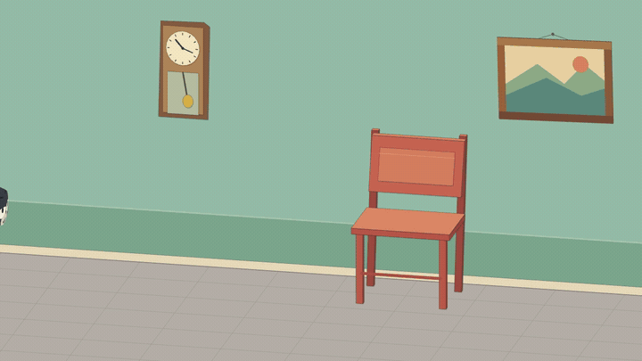

# Curio Motion

**Редактируемая 2D-анимация на TypeScript.** PixiJS рисует векторную геометрию; Remotion управляет кадрами, живым просмотром и экспортом MP4.

[Стабильная 1.0.0 и проверенный ZIP](https://github.com/vvvivaldy/curio-motion/releases/tag/v1.0.0) · [English](README.md) · [Документация](docs/README.md)

## Запуск

Это исходный проект, не npm-пакет. Проверенная среда — **macOS arm64**, Node ≥22.12 (контрольные версии выпуска: 22.12.0 и 26.13.0), npm и браузер с WebGL. Просмотр и экспорт на Windows/Linux пока не проверены.

Скачай ZIP релиза или клонируй репозиторий. В папке проекта выполни:

```sh
npm ci
npm run check
npm run demo:raccoon
```

Открой адрес, напечатанный Vite. Для звука нажми play. `npm run dev` запускает сервер без открытия страницы. Аккаунт нейросети, API-ключи и облачный сервис не нужны.

## Примеры

[](docs/assets/cat-picture-story-v3.mp4)

| Пример | Живая сцена | Фильм |
| --- | --- | --- |
| Утренний маршрут: персонаж, звук и инфографика | `/player.html?example=morning-delivery` | [36 секунд](docs/assets/morning-delivery-accepted-v1.mp4) |
| Енот-курьер: письмо, хват и сумка | `/player.html?example=raccoon-courier` | [16 секунд](docs/assets/raccoon-courier-anatomy-sound-v3.mp4) |
| Инфографика с изменяемыми учебными данными | `/player.html?example=delivery-infographic` | [12 секунд](docs/assets/delivery-infographic-first-pass.mp4) |
| Кот, стул, часы и падающая картина | `/player.html?example=cat-picture-story-v3` | [35 секунд](docs/assets/cat-picture-story-v3.mp4) |
| Неон со свечением и отражением от пола | `/player.html?example=human-chair-neon-confident` | [8 секунд](docs/assets/human-chair-neon-confident-v1.mp4) |

[Все актуальные примеры и архив беты](docs/EXAMPLES.md). Очистка относится к ветке main; исходный ZIP релиза 1.0.0 не менялся. Ранние эксперименты помечены отдельно; промежуточные фильмы и рабочие журналы доступны в истории Git, а не загружают текущую папку. Это авторские сцены, не автоматическое преобразование любого референса в мультфильм.

`/viewer.html?example=…` показывает сохранённый фильм и исходники; `/index.html?example=…` — прямую отрисовку Pixi. Для включённых сцен приватные авторские референсы не нужны.

## Экспорт

Отдельно установи Chrome/Chromium. Автоматической загрузки браузера нет.

```sh
# Укажи путь только если установленный браузер не найден.
export CHROME_PATH="/path/to/installed/chrome"
COMPOSITION_ID=RaccoonCourier RENDER_AUDIO_CODEC=aac npm run render
```

Результат — `outputs/raccoon-courier-remotion.mp4`. [Другие композиции, PowerShell и решение проблем](docs/DEVELOPMENT.md).

## Своя сцена и агенты

Открой папку в кодинг-агенте, приложи цельный референс и явное задание. Начни с [AGENTS.md](AGENTS.md), [локального навыка](.agents/skills/curio-authoring/SKILL.md) и [рекомендаций пользователю и команде](docs/USAGE_RU.md). Для небольшой задачи достаточно автора и человека; сложные взаимодействия стоит проверять независимым критиком.

`npm run create:example -- …` создаёт пустую типизированную сцену и инструкции. Рисунок и движение пишет автор. [Создание сцен](docs/AUTHORING.md) · [API](docs/API.md) · [Стабильные контракты](docs/API_STABILITY.md) · [Каталог звуков](docs/SFX_CATALOG_RU.md).

## Права и поддержка

Оригинальный код — [MIT](LICENSE). У рисунков, звуков и Remotion отдельные условия: [ASSETS](ASSETS.md), [THIRD_PARTY_NOTICES](THIRD_PARTY_NOTICES.md).

[Поддержка](docs/SUPPORT_RU.md) · [Совместимость](docs/COMPATIBILITY_RU.md) · [Участие](CONTRIBUTING.md) · [Безопасность](SECURITY.md) · [История изменений](CHANGELOG.md).
