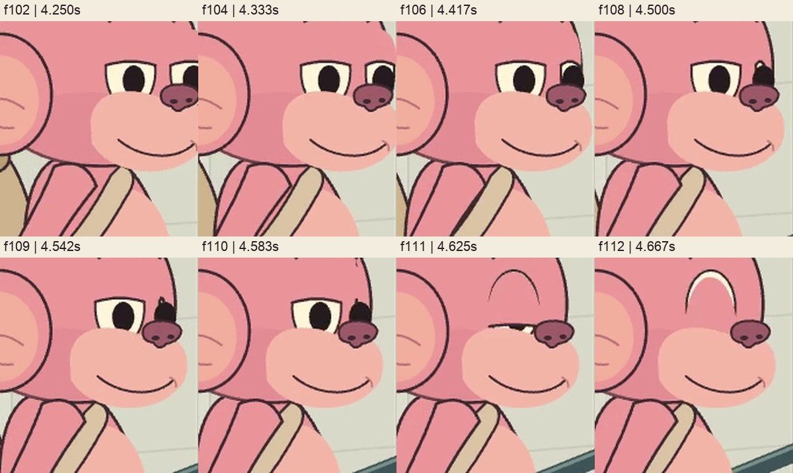
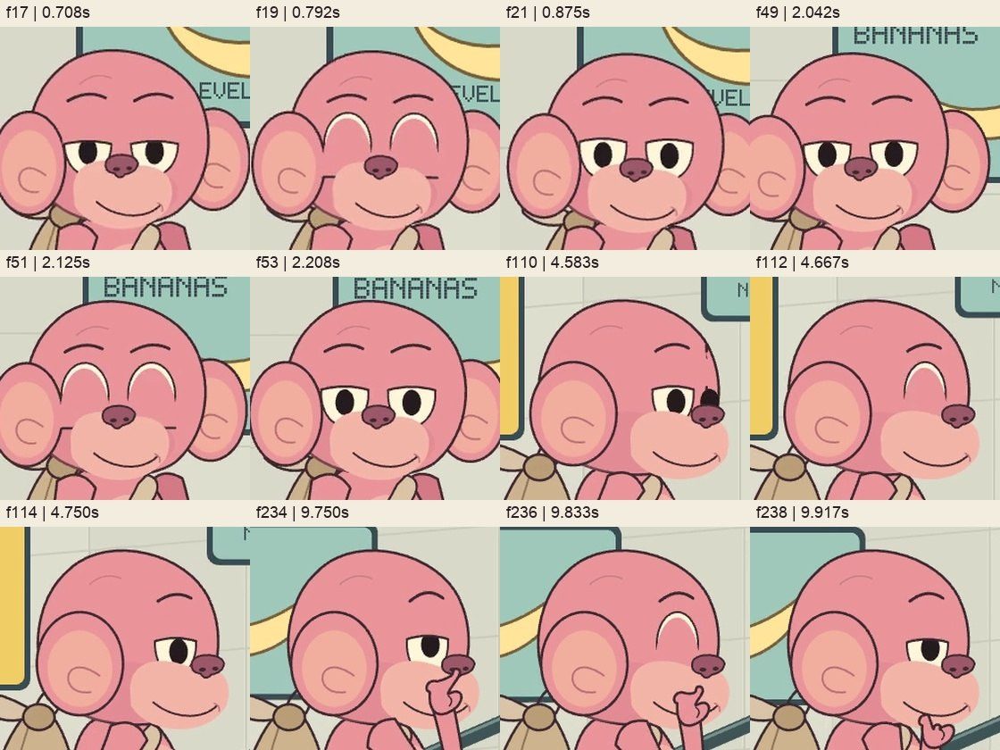
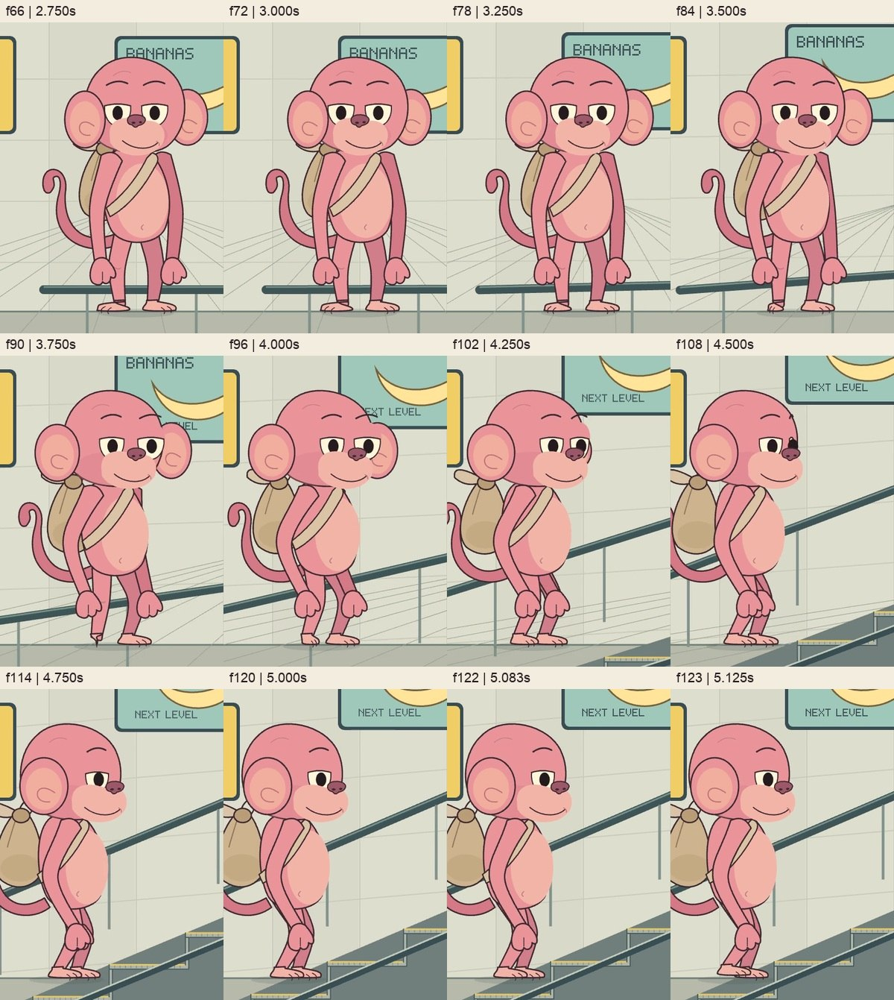
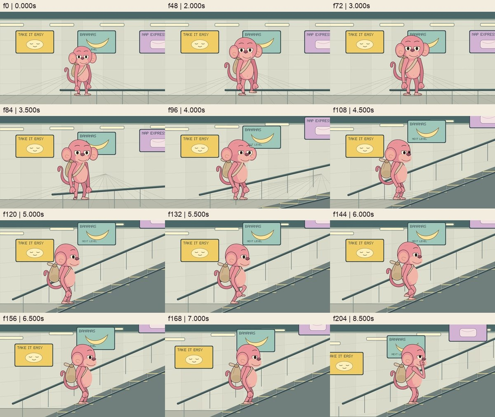
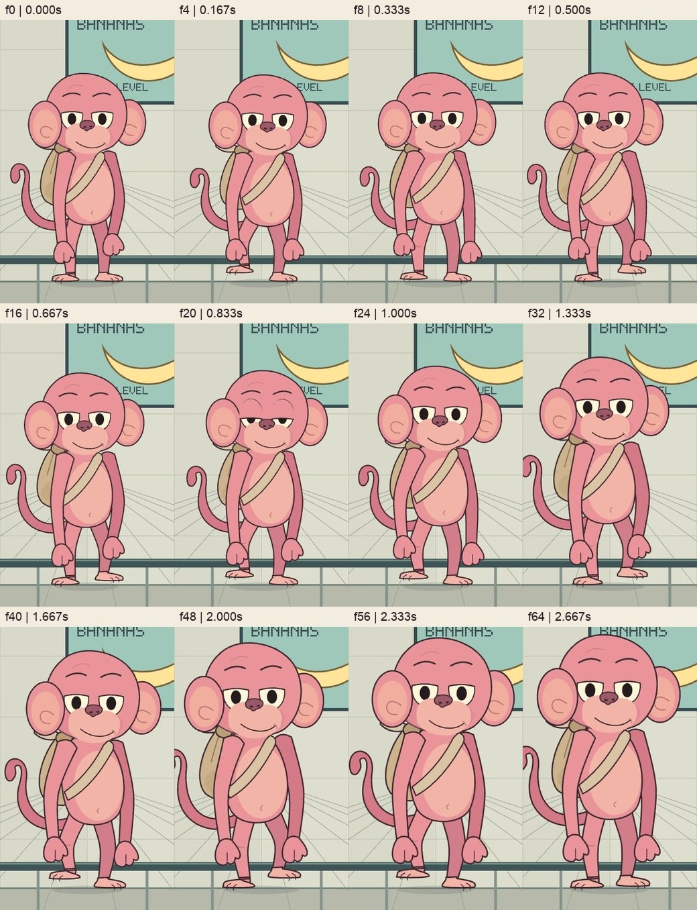
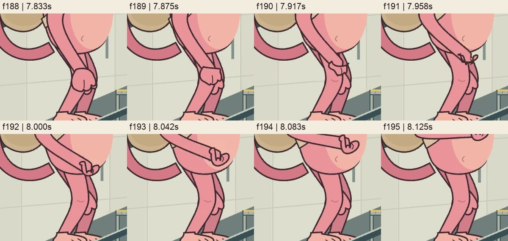

# Curio Motion: разбор качества и план улучшения

Дата: 26 октября 2026. Объект разбора — существующий авторский пример, а не работа автоматического сервиса генерации.

Исследован `docs/assets/demo.mp4`: 12 секунд, 1280×720, 24 fps, 288 кадров. Исходный код: commit `12ccf7b023131dddabc1f0ff9f51ead46ebd737d`. SHA-256 фильма: `4b0164472dd0537cb2573aa501ab793f0c9826bc5f79ed252aecae6ad70f13bc`.

Из фильма декодированы все кадры; подробно сопоставлены последовательности подхода, поворота, посадки, морганий и движения кисти. Наблюдения проверены по `motion.ts`, `illustration.ts`, `environment.ts` и существующим тестам. Иллюстрации ниже — подписанные кадры/крупные планы именно этого MP4. Время кадра: `frame / 24`. Результаты вычислений сохранены в [diagnostics.json](reviews/2026-10-26/diagnostics.json).

Исторический аудит ниже относится к исходному beta-фильму. По последующему поручению владельца реализован первый пакет E01–E04: новые общие функции и их подключение к примеру. Результат первого пакета — `docs/assets/demo-v2.mp4`, GIF — `docs/assets/demo.gif`; исходный `demo.mp4`, baseline и опубликованный beta-релиз сохранены. Результаты реализации — в [VERIFICATION.md](VERIFICATION.md). Остальные художественные пункты остаются планом дальнейших проходов.

Следующий согласованный проход E05 реализован через общие `sampleFootsteps`, `supportBalance`, `placeOnPivot` и `fitVerticalShift`: четыре продвигающихся шага, перекат пятки/носка, предварительный перенос веса и принятие нагрузки. Результат второго пакета — `docs/assets/demo-v3.mp4`. Это первая визуально проверенная походка для одного персонажа, не доказательство универсального генератора. Кисть/читаемость жеста и точность модели остаются отдельными проходами.

Третий пакет E06/E07 реализован через общие согласованные кубические контуры, локальные системы запястья, контактные якоря и конечные движения с остановками. Текущий фильм — `docs/assets/demo-v4.mp4`; `demo-v3.mp4` сохраняет предыдущую походку/кисть. Переходы ладони и контакт просмотрены в реальных соседних кадрах. Основной будущий художественный проход — точность модели и цельные виды E08; второй пример остаётся отдельным поручением.

Четвёртый пакет E08 выполнен: общая интерполяция цельных видов, авторские front/¾/profile формы головы/уха/мордочки/тела/живота/сумки и полные контуры стоп. Исправлены посадка ближнего уха, выступ дальних черт и схлопывание стопы при смене направления. По дополнительному замечанию владельца эскалатор получил непрозрачную заднюю панель, подступенки и боковину через общую геометрию ступеней. Все 575 полных поз движения совпадают с v4; рисунок изменён намеренно. Текущий фильм — `demo-v5.mp4`. Это более подробная стилизованная интерпретация референса, не автоматическое восстановление объёма и не заявление о точном совпадении. Второй пример и процесс генерации остаются отдельными будущими поручениями.

Пятый пакет выполнен по отдельному поручению: второй персонаж Эмбер берёт лейку, поливает растение дважды и возвращает её. Он использует тот же численный API и общий Remotion-мост; исходные данные обезьяны не импортируются. Размер/fps/длительность отличаются, первый фильм и GIF сохранены. [Отчёт о переиспользовании](REUSE.md) отделяет проверенные общие средства от авторской геометрии/тайминга и от ещё не проверенных обобщений. Это не испытание автоматической генерации по произвольному новому референсу.

## Главный вывод

Основное ограничение сейчас — качество авторской геометрии, постановки движения и визуальной проверки. Выделенный API обеспечивает воспроизводимое рисование, но не исправляет рисунок и не задаёт правила хорошей анимации. Равенство всех 288 кадров baseline доказало отсутствие изменений при выделении API; оно сохранило и ошибки baseline.

Чтобы заметно улучшить результат нейросетевого автора, нужны две связанные работы: исправить текущий пример до более сильного визуального эталона и построить процесс написания кода с промежуточными визуальными проверками. Автоматического генератора пока нет; текущий фильм не позволяет оценивать качество такой ещё не реализованной системы.

## Подтверждённые ошибки

### E01. Дальний глаз превращается в чёрный выступ — P0

**Где:** примерно 4,4–4,6 с, особенно кадры 106–110. На f108 над носом виден чёрный выступ, затем элемент пропадает.

**Причина:** `illustration.ts`, функция `head/drawEye`. Горизонтальный радиус дальнего белка уменьшается с поворотом, а радиус зрачка остаётся 9,5. На f108 радиус белка около 3,61; на f110 около 0,19. Зрачок не ограничен формой глаза. Параметр `far` фактически не используется для отдельного поведения. При `cos(yaw) <= .12` дальний глаз целиком перестаёт рисоваться.

**Исправление:** согласовать глаз, зрачок, веко и скрытие за объёмом головы; ограничивать видимую часть зрачка формой открытого глаза. Не устранять дефект одним скрывающим морганием.

**Готово, когда:** на всём повороте, включая открытые глаза, не появляется выходящего из белка зрачка/остатка века; скрытие дальнего глаза выглядит естественно на соседних кадрах.

### E02. При закрытии глаз остаются белые дуги — P0

**Где:** например f19 / 0,792 с, f51 / 2,125 с, f112 / 4,667 с и f236 / 9,833 с.

**Что видно:** глаз должен закрыться, но над веком остаётся светлая дуга. Это повторяющийся дефект геометрии, а не H.264-размытие.

**Причина:** белок нарисован целиком, затем закрывается отдельной заливкой века. Форма этой заливки не покрывает верх белка на пике моргания; полноценного ограничения области глаза нет.

**Исправление:** строить видимую апертуру глаза из параметра открытия, согласованно обрезать белок и зрачок. На полном закрытии остаётся линия века, без белой щели.

**Готово, когда:** пиковые и соседние кадры всех морганий чистые спереди, в ¾ и в профиль; характер сонных глаз сохранён.

### E03. Поворот сопровождается скольжением обеих стоп — P0

**Где:** 2,8–5,1 с. Походка уже остановлена (`walk = 0`), подъёма стоп нет, уровень подошв остаётся y=650. При этом персонаж перемещается влево.

**Проверяемые значения из `pose(t)`:**

| Время | Root X | Проекция левой стопы X | Проекция правой стопы X | Подошвы Y |
| --- | ---: | ---: | ---: | ---: |
| 2,8 с | 640 | 610 | 670 | 650 |
| 4,0 с | 569,71 | 543,40 | 596,02 | 650 |
| 5,1 с | 510 | 494 | 526 | 650 |

Экранные точки стоп смещаются на 116 и 144 px без поворотных шагов. При настоящем движении камеры экранная координата опоры может меняться; здесь общей проекции камеры и мира нет, а преобразования фона не дают согласованного объяснения этому перемещению. В фильме движение читается как скольжение по полу.

**Причина:** `root.x = 640 - 130 * turn`, независимое изменение проекции ног и отсутствие зафиксированных опор в фазе поворота. Поле `planted` становится true только после 6,4 с и не описывает более ранние контакты.

**Почему тесты пропустили:** `scripts/check.ts` проверяет фронтальную опору при `t < 2.35`, посадку при `t >= 5.1` и стояние после 6,4 с. Промежуток 2,35–5,1 с не проверяется на сохранение опор. Длина ног и плавность коленей этого не выявляют.

**Исправление:** сначала определить постановку камеры и персонажа. Для ближайшей версии рекомендована неподвижная камера во время разворота и короткие явные поворотные шаги/поворот вокруг опорной стопы. Контакт задаётся в координатах пола; таз и свободная нога строятся относительно него. Смещение в сторону эскалатора должно происходить через шаги.

**Готово, когда:** в каждой фазе есть понятная опорная нога, она не едет по поверхности; поворот и перемещение считываются как действия персонажа. Если камера движется, она одинаково преобразует стопу, пол и остальные привязанные объекты.

### E04. Поворот персонажа деформирует станцию — P1

**Где:** 2,8–5,1 с; отдельная несогласованность продолжается при поездке.

**Что видно:** ступени разворачиваются/поднимаются из почти плоской конфигурации, линии стены наклоняются, плакаты остаются прямоугольными без соответствующего преобразования. Линии пола исчезают по порогу `turn >= .95`. Пространство воспринимается как меняющая форму декорация.

**Причина:** `environment.ts` использует `q.turn` как `orbit` и отдельно меняет наклон, положение и высоту разных объектов. Во время поездки плакаты движутся с коэффициентом 1, а сетка стены — 0,75. Если плакаты прикреплены к той же стене, их привязка нарушается: к последнему кадру относительное горизонтальное смещение составляет около 105,6 px. Разные скорости допустимы для разных глубин, но не для жёстко прикреплённых объектов одного слоя.

**Исправление:** отделить `characterYaw` от камеры. Эскалатор должен существовать как согласованная конструкция с начала сцены. Для поездки достаточно одного преобразования камеры/слоя; плакаты наследуют преобразование стены. Настоящий обход камеры — отдельная более сложная постановка, если он будет нужен.

**Готово, когда:** поворот головы/тела не меняет геометрию станции; прикреплённые объекты сохраняют взаимное положение; переход к сопровождению эскалатора непрерывен. Нового 3D-движка для этого не требуется.

### E05. Подход напоминает мелкое переступание с увеличением масштаба — P1

**Где:** 0–2,8 с.

**Наблюдение:** рост персонажа в кадре показывает приближение, но шаги слабо выражают продвижение и вес. Стопы почти плоские, переката нет, руки и корпус движутся по очень регулярным циклам. Это художественная оценка, а не ошибка длины костей.

**Основание в коде:** root остаётся на месте; масштаб меняется с 0,82 до 1; цикл шага — 0,72 с, подъём стопы до 19 локальных единиц. Таз/плечи следуют небольшим синусоидальным смещениям, без явно заданных ключевых поз контакта, переноса веса и прохождения ноги.

**Исправление:** поставить сначала несколько читаемых поз шага: контакт, принятие веса, проход, отрыв. Согласовать продвижение/перспективу, длину шага и его частоту. Затем добавить небольшое запаздывание рук, головы и кулька. Сонный характер требует спокойной пластики, а не дополнительных случайных колебаний.

**Готово, когда:** даже в силуэте понятно, на какой ноге вес и куда движется персонаж; остановка происходит в устойчивой позе. Проверка неподвижных опор остаётся обязательной, но не единственной.

### E06. Кисть теряет убедительный объём на сборке пальцев — P1

**Где:** около 7,88–8,08 с, особенно f190–191; похожую область нужно проверить при возврате.

**Что видно:** при подъёме руки кисть сплющивается/заламывается у запястья. Замкнутость контура сохранена, однако форма не выглядит устойчивой ладонью, которая поворачивается и собирает пальцы.

**Причина:** в `hand()` контрольные точки двух существенно разных контуров смешиваются по индексу в экранных осях. Локальная ориентация ладони и запястья не задаётся. Фазы `curl/extension` вычисляются внутри рисунка из жёстких секунд конкретной сцены.

**Исправление:** несколько согласованных авторских форм ладони с одинаковым смыслом контрольных точек; локальная система кисти от предплечья и осмысленный поворот запястья. В рисунок передавать параметры сгибания/указания и цель контакта из позы, а не абсолютное время сцены. Контуры по-прежнему строятся кодом; части референса не вырезаются.

**Готово, когда:** в каждом соседнем кадре читаются ладонь, запястье и указательный палец; нет схлопывания, неожиданных выступов и резкой смены объёма. Кончик пальца сохраняет заданный контакт у носа.

### E07. «Почёсывание» слабо отличается от удержания пальца — P2

**Где:** 8,52–9,5 с.

**Основание:** рассчитанный радиус движения целевого кончика пальца на реальных кадрах 24 fps не превышает примерно 1,14 px; при уменьшении фильма до ширины 320 px это менее 0,29 px. Рука движется сильнее в других точках, но собственно контактное движение пальца почти не читается. Текущий тест ограничивает амплитуду сверху 1,3 px и не проверяет смысл действия.

**Исправление:** поставить два коротких читаемых движения с паузой, проверить небольшое согласованное участие запястья/головы и сохранить контакт с носом. Амплитуду и темп выбирать по реальному кадру, а не повышать безусловно. Отдельно проверить, отличает ли зритель почёсывание от касания.

### E08. Узнаваемость есть, но воспроизведение референса упрощено — P1/P2

Референс уже содержит цельные front/¾/profile виды. В коде внешний контур головы практически одинаков для всех углов: в основном перемещаются черты лица и уши. Профиль получается из фронтальной головы. Кисти читаются как простые варежки, ступни и их объём упрощены, хвост выглядит более массивной лентой. Характер сонного взрослого персонажа частично превращается в нейтрально улыбающийся знак.

Это оценка сходства/стиля, а не требование копировать пиксели. Сначала нужны три цельных вида, нарисованных кодом, и их сравнение с [цельным референсом](../reference/pink-monkey-reference.png). Проверять пропорции головы/морды/живота, силуэт, стопы, кисти, крепление сумки и выражение глаз. После этого строить промежуточные углы и проверять объём на повороте.

## Что стоит сохранить

- Новые векторные контуры из кода, цельный референс как авторский вход, Pixi для рисунка и Remotion для времени/экспорта.
- Детерминированный кадр и совпадение direct Pixi/Remotion при обратной перемотке.
- Существующие точные опоры после посадки, горизонтальные проступи и работающий контакт у носа на установившейся позе.
- Спокойный характер и осмысленные остановки. Нулевая скорость в паузе — допустимый художественный выбор.
- Исходный фильм/код/референс как исторический baseline. Улучшенная версия получает отдельные файлы и новую визуальную оценку.

## Порядок разработки

| Этап | Работа и результат | Условие перехода |
| --- | --- | --- |
| 0. Аудит — выполнен | Этот разбор, кадры с таймкодами, вычисления, список пробелов тестов | Ошибки воспроизводимы, факты отделены от художественных оценок |
| 1. Убрать явные дефекты | Отдельный небольшой PR для глаз/век; следующий — опоры на повороте и согласованная постановка мира | E01/E02/E03 устранены, соседние кадры чистые; контакты проверены на всём фильме |
| 2. Утвердить рисунок | Три цельных кодовых вида и промежуточные углы, кисть/стопа, объём головы/тела, порядок перекрытий | Персонаж узнаваем в front/¾/profile; нет выступающих черт и схлопывания форм |
| 3. Перепоставить движение | Ключевые позы ходьбы/поворота/двух шагов; затем жест и внимание; затем только необходимое вторичное движение | Походка несёт вес, станция стабильна, жест читается без пояснения |
| 4. Выделить полезные средства библиотеки | Только проверенные на этой работе опоры, преобразования, якоря, параметры жеста и интерполяция согласованных форм | Пример остаётся читаемым; каждая новая абстракция устраняет конкретное дублирование/ошибку |
| 5. Улучшить процесс нейросетевого автора | Поэтапное написание сцены, обязательный просмотр промежуточных результатов, локальные исправления с повторной оценкой | Улучшение видно в A/B; техническое прохождение не заменяет визуальную оценку |
| 6. Проверить переносимость качества | Затем отдельное поручение на второй пример; позднее небольшой фиксированный набор других действий/персонажей | Успех подтверждён вне одной обезьяны; условия и неудачи записаны |

Не расширять библиотеку раньше, чем исправлены явные ошибки текущего потребителя. Для первого практического этапа рекомендован узкий объём: E01–E04 и недостающие проверки. Он даёт наиболее заметное улучшение и создаёт основание для следующего прохода по рисунку/походке.

## Каким должен стать небольшой API

Это направления извлечения после работающего исправления, не спецификация универсального движка:

- **Контакт с поверхностью:** явные интервалы опоры и точки пятки/носка, одна привязка к полу/ступени, положение таза и свободной ноги относительно опоры. Поворот тоже является движением с контактами.
- **Пространства координат:** явное различие world/local/screen; одно преобразование камеры для связанных объектов. Не смешивать root, локальную анатомию и экранную цель контакта в одной формуле.
- **Якоря:** согласованные положения плеча, запястья, носа, крепления сумки; геометрия и решатель используют один источник. Сейчас рисунок возвращает носовой якорь из `head()`, но вызывающий код заново вычисляет приближённую формулу — текущая статичная фаза это скрывает.
- **Параметры позы:** рисунок получает открытие глаз, направление взгляда, сгибание пальцев, ориентацию ладони, фазу контакта. Абсолютные секунды конкретного фильма остаются в постановке.
- **Формы:** интерполяция совместимых контуров и предсказуемое скрытие дальних деталей; контроль объёма и силуэта между ключевыми видами.
- **Надёжная математика:** если `joint()` будет извлекаться, сначала обработать совпавшие точки, слишком близкую/далёкую цель и коллинеарный pole; конечные значения должны проверяться. Текущий пример не является доказательством общей корректности решателя.

Сохранить простой TypeScript. Новый язык сцен, графовый редактор, сервис моделей, очередь и платформа для этих задач не нужны.

## Процесс генерации, который должен повышать качество

1. **Разбор референса и действия.** Короткая спецификация пропорций, силуэта, характерных черт, контактов, последовательности действий и допустимых пауз. Наблюдаемое в референсе отделить от догадок о скрытых поверхностях.
2. **Статичный рисунок.** Кодовые front/¾/profile и ключевые формы кисти. Агент рассматривает реальные рендеры вместе с целым референсом и исправляет рисунок до движения.
3. **Черновая постановка.** Силуэты и ключевые позы в неподвижном пространстве. Проверяются вес, опоры, траектория, взгляд/намерение и длительности. Не тратить этот проход на украшения.
4. **Интерполяция.** Построить переходы, просмотреть каждый кадр в опасных местах: исчезновение дальних черт, полное моргание, посадка стопы, сборка/раскрытие кисти. Проверить обычную скорость и замедление.
5. **Разбор результата.** Для каждой ошибки записать время, кадр, видимый симптом и вероятную причину. Автоматические проверки дают кандидатов для просмотра; художественную оценку нельзя свести к ним.
6. **Локальное исправление.** Менять конкретную форму/траекторию/интервал, повторять затронутую проверку и смотреть весь фильм на регрессии. Не переписывать всю сцену и не добавлять шум движения для маскировки дефекта.
7. **Финальная оценка.** Сравнение с предыдущим вариантом, точное выполнение действия, визуальный просмотр, технические проверки и экспорт. Если качество не достигнуто, сохраняется явный список ограничений, а не формальная отметка «готово».

Этот процесс можно сначала выполнять текущим кодовым агентом локально, без подключения нового сетевого AI. Конкретные провайдеры и автоматическое управление моделью — отдельная последующая реализация, если она понадобится.

## Как принимать улучшенный результат

Предлагаемые условия, которые нужно откалибровать на первой исправленной версии:

| Область | Проверка |
| --- | --- |
| Опоры | Все интервалы контакта, включая замедление/поворот/посадку; начальная цель — дрейф не более 0,5 экранного px при неподвижной камере на 1280×720. При движущейся камере проверять координаты относительно поверхности/общей проекции. Якорь и нарисованная подошва должны соответствовать друг другу. |
| Лицо | Зрачки ограничены видимой апертурой; полное закрытие без белых дуг; все углы и соседние кадры без всплывающих дальних черт. |
| Кисть | Нет схлопывания/случайного пересечения контура на подъёме и возврате; читаемый палец, непрерывный контакт, убедительная ориентация запястья. |
| Пространство | Плакаты прикреплены к стене; персонаж и опоры используют согласованное преобразование; декорации не меняют форму от `characterYaw`. |
| Действие | В полном кадре и уменьшенном просмотре различимы подход, разворот, два шага, поездка, почёсывание и возврат. Проверять смысл действия, а не только координаты его цели. |
| Рисунок/пластика | A/B с исходным фильмом: более узнаваемый персонаж, вес и осмысленные позы. Паузы не должны проигрывать тест только из-за отсутствия движения. Численный «балл красоты» не вводится. |
| Рендер | `npm run check`, `check:port` и официальный `render` на существующем Chrome; direct Pixi и Remotion сравниваются уже для новой версии. Побитовое равенство со старым фильмом перестаёт быть целью художественного улучшения. |

Для последующей проверки генерации фиксировать входной референс/действие, версии кода/зависимостей, промежуточные результаты, число исправлений и итоговые ограничения. Отдельно оценивать сходство, исполнение действия, механику движения, целостность форм и воспроизводимость. Сначала нужен успешный второй пример; затем можно формировать набор из 3–5 коротких контрольных задач с отложенными примерами и повторными запусками. Обещать заданный процент улучшения до такого сравнения нельзя.

## Шестой пакет: механика второго примера и воспроизводимое ревью

Выполнен по отдельному поручению. Старый робот проходил тесты длины/контакта, но локоть перескакивал между f78–79 и f197–198: проекция постоянного pole меняла сторону при пересечении высоты плеча. Максимальный скачок на 240 Гц — 127,26 px, сгиб запястья доходил почти до 180°. Общий `solvePlanarLimb` задаёт явную сторону сгиба, проверяет предел запястья и запас сгиба локтя без нарушения контакта. Изменена достижимая постановка лейки; наклон происходит вокруг захвата. В новой выборке максимальный шаг локтя 0,788 px, сгиб запястья 70,545° при пределе 75°, минимальный сгиб локтя 26,201° при требовании 20°. Это подтверждение механики, а не художественный балл. Реальные кадры и оставшиеся ограничения — [разбор процесса](reviews/process/README.md).

[Общий процесс](AUTHORING.md) сохраняет цельный вход, наблюдения/допущения, порядок действия, промежуточные рендеры модели/ключевых поз/переходов, затем декодированные кадры официального финального MP4. Проверка требует актуальных хешей и отдельных записанных визуальных решений; открытые ошибки, пропавшие кадры, изменённые артефакты и устаревший исходник не проходят. Обе существующие сцены используют этот инструмент с собственными планами. Нейросетевой провайдер и автоматическое восстановление произвольного референса не реализованы; успешность на отложенных задачах пока не измерялась.
