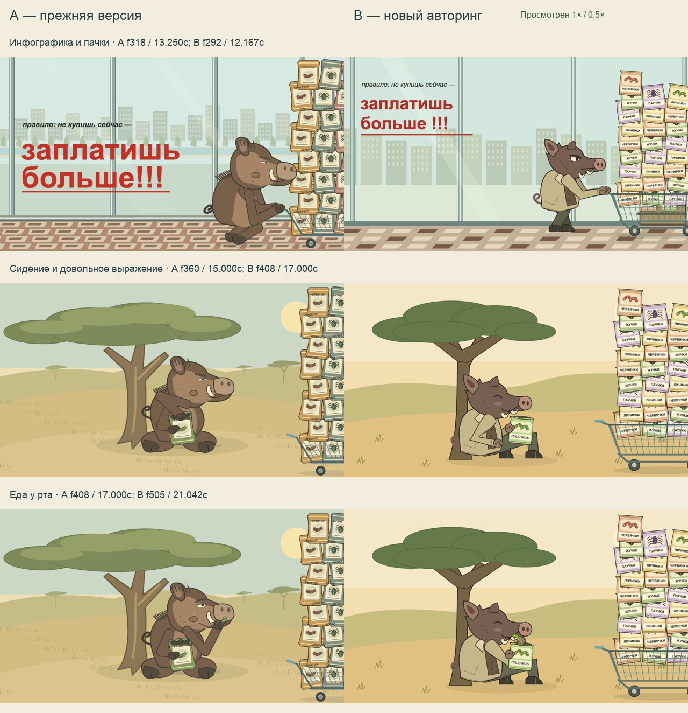
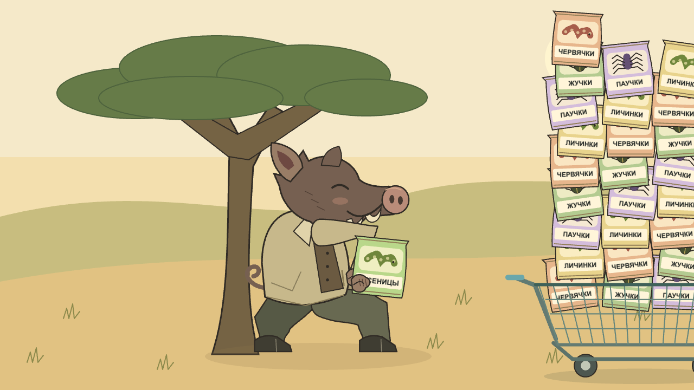
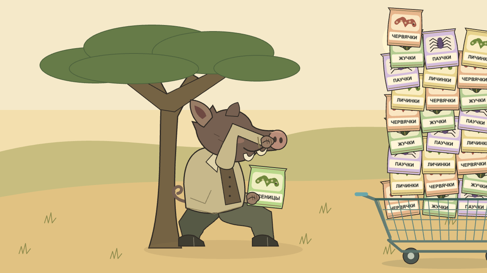
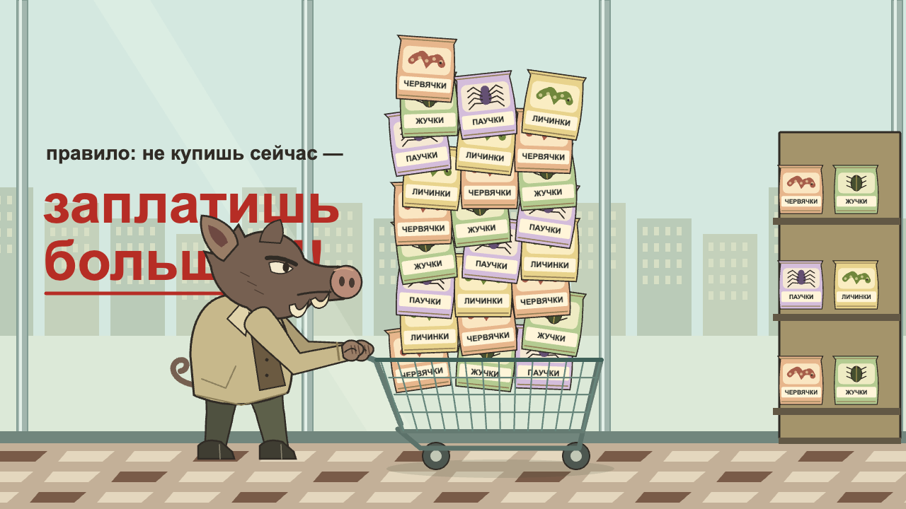
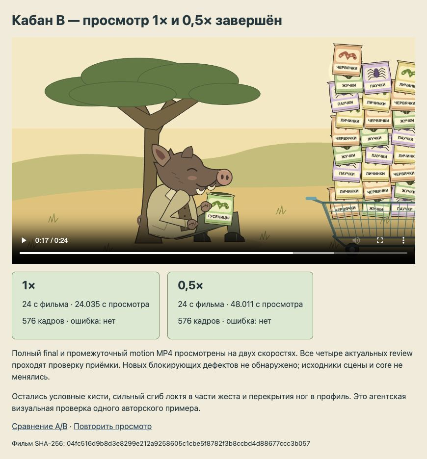

# Boar A/B: same whole input, fresh authoring

B has **completed coding-agent visual review**: current control drawings, decoded frames, and full final/motion MP4 playback at 1× and 0.5× have been inspected. All four current stage reviews pass delivery. No new blocking visual defect was found in the follow-up, so scene/core source and the official film bytes are unchanged. This is agent acceptance of this authored example, not owner approval or a guarantee for arbitrary scenes.

[New B film](../../assets/serious-boar-v2.mp4) · [preserved A film](../../assets/serious-boar.mp4) · [full side-by-side video](comparison.mp4) · [verification record](verification.json) · [playback record](playback.json) · [stage decisions](review-records.json).

The stills match **action moments**, with each exact frame/time printed. The side-by-side movie preserves both original 24-second timelines; they are not synchronized by action. A cuts to the savanna at 15 s, B at 16 s. All comparison images are decoded from the actual encoded films, never reference textures or animation inputs.

## What changed visibly

| Concern | Observed A/B result | General mechanism/process |
| --- | --- | --- |
| Packet labels cross other packets or look detached | B groups the opaque label, insect drawing and pack into the same transformed depth unit. Names fit inside their own label regions and rear labels occlude with rear packs. | `createIllustratedObject`, measured/minimum text fit, masks and actual transformed label bounds. |
| Seated legs look like large ovals | B408 has a low pelvis, forward thighs, separate knees/shins and two split hooves. | Shared continuous `limbShape` contours tied to the checked joints; required whole-pose visual review. The boar anatomy itself remains in the example. |
| Happiness is unclear | B408/505 shows an upturned smile, closed curved eye, relaxed seated posture and quiet hold. | Explicit required visible emotion criterion; a numerical `satisfied` parameter cannot approve it. |
| Hand/food relationship is unclear | B491 starts at the open packet rim;498 lifts,505 touches the lower mouth,509/511 shortens,513 disappears,516 returns/chews. | Shared anchors, actual mouth curve and selected grip/contact/clearance relations, then neighboring rendered-frame inspection. |
| Cart surges and hand throws in B motion 3 | Motion4 separates nominal travel from foot phases and uses one continuous reach/return arc with longer duration. All97 decoded excerpt frames inspected; full-speed perceived rhythm remains open. | General `sampleTravel`, existing curve evaluation, bounded support offset and a skill rule about travel/waypoint causes. |
| Warning layout | B292 reserves a clear region above the head and retains the source words. A318's large warning was already readable; this is not a claim that every A text was broken. | Layout criteria cover the actual complete rendered text and character silhouette. |

B uses a simpler, flatter and more angular illustration than A. Hands are still stylized mittens; the elbow is tightly folded at 485/516 and legs overlap in profile at some steps. Concrete relationships improve in these frames; this does not establish that every aspect of drawing or motion is better.

## Same input, independent B code

Whole local recording SHA-256: `44e3ff56d58d235e5444980bfc8daff0ae6f926be258702206c9e5c971adc9e1`.
Unchanged ACTION bytes SHA-256: `1c7852eb5c3e6c6e0b3538d848c16ed6b41bc923bfc5da26fd57cabdeb6671d0`.

The B author inspected the whole recording and ACTION, shared API and project skill. It was instructed not to read A's source, assets, plan or review as a template. A separate agent reviewed the new poses and requested repairs. B is a fresh authored implementation with review iterations, not an unattended generation run, a rerender of A or an independent unseen-task success-rate benchmark. The original source video remains local-only and does not enter runtime, Git or the static distribution.

## Actual repair ledger

| Rejected evidence | Visible symptom and cause | Repair and inspected evidence |
| --- | --- | --- |
| B model 1,292 | Head covered red warning: no reserved silhouette region. | Reserved upper-left layout; model 3/4 and encoded B292 show every line clear. |
| B model 1/2,408 | High pelvis read as crouching; shins/hooves merged. | Lower seated pelvis and distinct thigh/knee/shin/hoof forms; model 3/4 and encoded408/505 inspected by root and independent reviewer. |
| B model 1,498 | Forearm hid eye; food approached nose. | Stable elbow branch, lower actual mouth-curve anchor, visible food shortening; model 4 and encoded491→498→505→509→513. |
| B motion 3 | Cart visibly stopped/surged each step despite passing contacts; standing legs stayed crouched. | Independent smooth travel, raised reachable hips and bounded support shift. Decoded 220–265, every-frame geometry and later complete normal/slow final/motion playback checked. |
| B motion 3 reach | Three large separately eased waypoints in 0.2 s produced a throw. | One 0.45 s preparation arc and one 0.45 s return, explicit pickup/lift/bite holds. Every decoded 477–527 frame and later both complete bites at normal/slow playback inspected. |
| Shared label fixture | Reparented/masked Text reported false fit/overflow. | Use intrinsic `Text.bounds` with actual transformed vertices. Real Chrome fitting, minimum-size rejection, mask/occlusion, reparenting, rotation/pivot/skew/scale fixture passed. |
| Shared ACTION validation | A changed ACTION could pass a declared `unchanged` manifest. | Check pinned action hash and its link to plan `actionFiles`; regression tests reject changed bytes. Legacy manifests remain compatible. |
| Shared private-input filter | Different letter case on macOS could bypass exact-path exclusion. | Resolve the actual filesystem spelling, without indiscriminate lowercasing; real case-insensitive filesystem test passed. |

Rejected model 1 evidence is retained below; it is not final or approved:

## Verification and completed playback review

- Pinned `npm ci`; final `npm run check` passed types, numerical core,18 authoring/scaffold/distribution tests and static build.
- `check:port` passed 505 exact native Pixi/Player comparisons, backward/random seeks, zero runtime image requests/page errors. All423 old-example records match their saved baseline.
- Default official monkey re-export: all 288 decoded frames exactly match preserved v5. All13 existing MP4/GIF files, whole source and ACTION are byte-preserved.
- New official B:1280×720, 24 fps,576 frames,24 s,silent H.264,2,205,456 bytes; no page errors. Source fingerprint: `02e52f56a803f81acad4186baca12142c2df0a0b30d67516485cd4add8aebc33`; film SHA-256: `04fc516d9b8d3e8299e212a9258605c1cbe5f8782f3b8ccbd4d88677ccc3b057`.
- Current captures: model 15, blocking46, motion 96 and final96 PNGs, plus a half-size official motion movie and full final movie. Root/independent reviewers inspected model/blocking poses,97 complete excerpt frames, a 24-frame full-film sheet and native encoded details. This is not a claim that all 576 final images were visually inspected.
- All576 integer poses passed 18,799 geometry checks. Geometric success never approved a rejected model or motion draft.
- New GIF:720×405, 12 fps,288 frames,24,000 ms,infinite loop. Its encoded metadata and bytes were checked; a new browser animation/playback observation was unavailable.
- Official excerpt receipts are marked QA-only; a real attempted final capture using an excerpt was rejected.
- **Playback completed:** final and motion MP4s at 1× and 0.5×; continuous live screen evidence, whole-film overviews, all selected critical approach/push/bite screen sequences inspected. Final: 24.035/48.011 s with 576 callbacks each. Motion: 24.003 s/575 callbacks and 48.030 s/576 callbacks. The missing first normal motion callback is frame zero already displayed as poster. No decoder errors. [Exact playback observations](playback.json) and [stage decisions](review-records.json). Callback completion verifies decoding; visible motion judgments come from inspecting the moving sequence and contacts, not that count.

Local records: `qa/authoring/serious-boar-v2`, `qa/independent-boar-review/observations.json`, `qa/boar-v2-delivery-status.json`, `qa/check-final.log`. The final run used a source-hash-identical recovery workspace on the internal disk after SSD I/O failures; outputs/evidence were copied back to the primary project. No new dependency, hosted model, publication or deployment was introduced. Browser/render evidence is macOS only.
