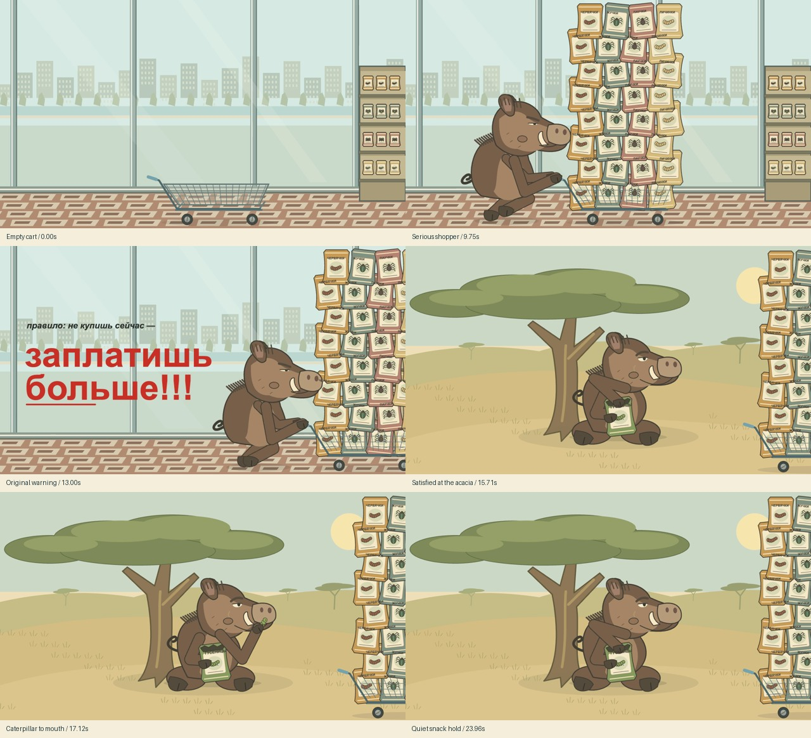
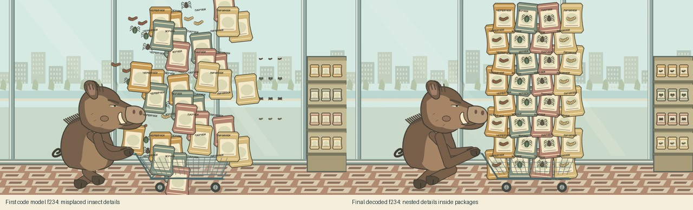

# Independent reference trial: serious boar

Status: implemented and previously accepted in the coding agent's local review, then challenged by the owner for unresolved visual defects. Technical verification stands; visual quality needs another pass. The current movie remains the comparison baseline and is not recorded as owner-approved.

## Owner feedback after the agent review

The owner reports that product names appear detached/translucent and overlap other packets; the seated character does not clearly look satisfied; arms look awkward and seated legs read as large ovals. Reinspection confirms detached top-layer labels, overly simplified seated legs and weak expression readability. The earlier agent acceptance was too permissive and did not resolve these issues.

Code evidence: cargo/snack `Text` objects are added to the scene root and placed separately from packet contours; they lack shared per-package occlusion/clipping. The seated hind legs are two ellipses with hoof shapes. An IK reach check and a numeric happiness parameter do not establish readable anatomy or emotion. These are open defects, despite the earlier resolved rows below and passing renderer/contact tests.

The owner requests a new authoring pass from the same whole video and original brief after shared/process improvements, followed by a direct comparison against this saved movie. See the [revised next steps](../../NEXT_STEPS_RU.md). New acceptance must address these specific defects in actual frames; one known-task comparison is not a general generation benchmark.

The owner supplied a whole 19.316667-second 1280×720 screen recording, independently of the existing scene designs. Its bytes are pinned in [the input manifest](../../../reference/serious-boar/authoring-input.json); [the action](../../../reference/serious-boar/ACTION.txt) records the replacements and the later satisfied-eating clarification. The recording remains a local authoring input and is excluded from source distribution.

Observed sequence: empty wire cart in front of shop windows; increasing tower of goods; man enters from the left and pushes right; small black italic rule followed by a large red warning. Exact text: «правило: не купишь сейчас — заплатишь больше!!!». The source cashier shot is replaced by the requested savanna continuation.

The new design is a stocky brown boar with a long snout, tusks, cheek wart and mane. Four insect product families replace the original goods. At an acacia the same boar sits with a relaxed smile, holds an open caterpillar packet, takes three snacks and rests. A clipped view of the loaded cart remains on the right. The official film is 24 seconds, 1280×720, 24 fps, 576 silent H.264 frames. Its renderer uses authored geometry, with no source footage or audio.

## Actual repair ledger

| Evidence | Visible failure | Cause and repair | State |
| --- | --- | --- | --- |
| First native f234/f377 | Insect illustrations floated outside packets | Nested transforms altered the parent translation. Shared `withGraphicsFrame` composes the local matrix and restores its parent. Official model frames now keep insects inside packets. | Corrected and inspected |
| Early model f234 | Opposing knee branches crossed the legs | Changed this character's side-view knee direction and hip height; checked reach over the film. | Inspected in final f234 and native f227–235 |
| First blocking f310 | Cart left before the warning finished; text too small | Gradual accelerating push and larger warning, with the original wording. | Inspected in final f312/f348/f359 |
| Early eating model | Brown worm and approximate mouth target obscured the requested caterpillar bite | Distinct green segmented caterpillar; drawing/contact share the actual mouth curve. Pickup begins at the bag opening. | Inspected in final f402/f411/f479/f493/f550 and their native neighbors |

Shared scene registration removes repeated two-example renderer branches. Both previous examples matched all 330 saved native Pixi/Player baseline comparisons after registration changed. Their existing films and GIFs are preserved.

Four completed model captures, two blocking passes, two motion previews and one final decoded-film capture remain locally available, along with the first bad model and an interrupted blocking capture. These are saved runs, not nine independent generation attempts. Final reviews cover 3 model + 13 blocking + 45 motion-neighbor + 18 decoded final frames; both motion and final films were played through at 1× and 0.5×. The early/final comparisons expose the manual repairs instead of treating constraints as proof of drawing quality.

Numerical checks include 2,304 boar poses, planted hooves, reach, cart grip, mouth/food/bag anchors and deliberate holds. Shared nested-transform checks also exercise error cleanup. The 11 pre-existing MP4/GIF files retain their exact Git-baseline SHA-256 values. [Verification](../../VERIFICATION.md) records the checks and delivery status. Local capture/review records stay in ignored `qa/`; the owner's recording is not included in these public review sheets.

This is one agent-authored trial. Geometry, staging and timing are written in TypeScript. It does not establish automatic video interpretation, a generation success rate or general physical simulation. The new artwork is a simplified original vector interpretation; the source's drawing style is not reproduced exactly. The supply tower is deliberately exaggerated, as in the source composition. Organic wrist limits are broad and there is no general collision solver. The useful next steps remain a small authoring starter, targeted clearance diagnostics and narrower QA invalidation, rather than a larger scene language.
