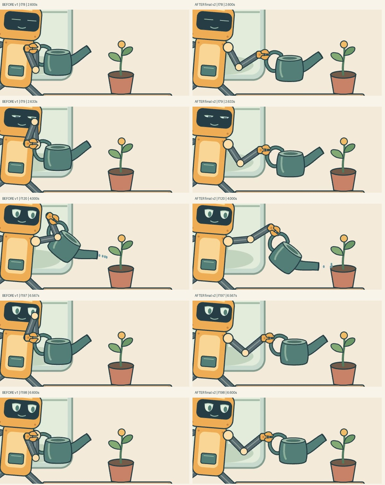
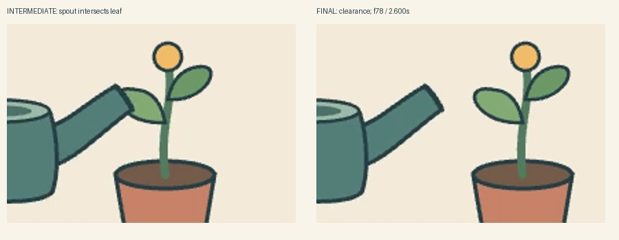
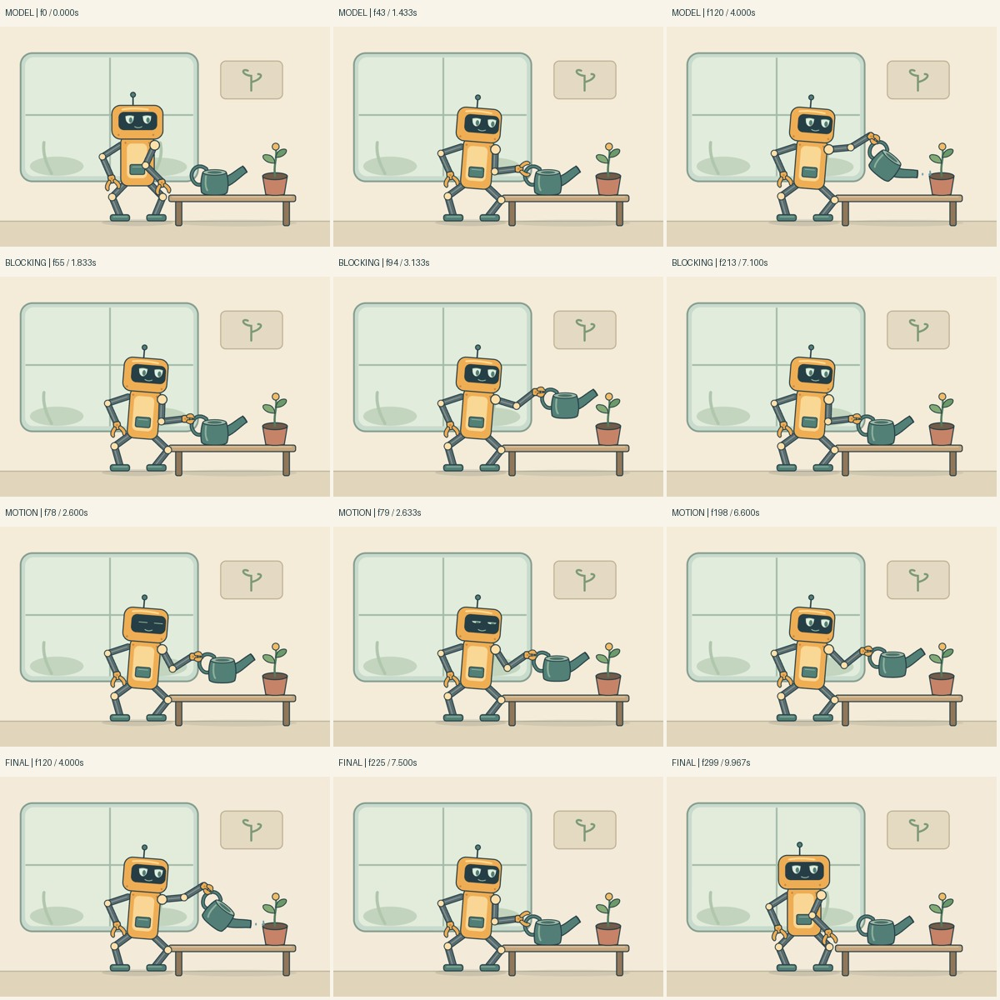

# Пакет 6: механика руки и проверяемый процесс автора

Объекты: сохранённый `docs/assets/amber-robot.mp4` (v1), новый `amber-robot-v2.mp4`, неизменённый `demo-v5.mp4`. Референсы остаются цельными и используются только автором/viewer. Ни кадры фильмов, ни эти сравнения не входят в сцену.

## Что было не так и что исправлено

| Ошибка | Кадры / время | Видимый симптом и причина | Исправление и результат |
| --- | --- | --- | --- |
| R01 — смена ветви локтя | f78→79 / 2,600→2,633 с; f197→198 / 6,567→6,600 с | Локоть прыгает от пояса к лицу при плавной кисти. Постоянный мировой pole после проекции меняет сторону при пересечении высоты плеча. Проверка длины костей это пропускала. | Общий `solvePlanarLimb` выбирает явную знаковую сторону сгиба. В соседних кадрах ветвь сохраняется; прежний 127,26 px скачок исчез. |
| R02 — залом запястья и подъём руки к лицу | захват f43–55, подъём f78–96, полив f118–122 и f159–161 | Клешня следует углу лейки, а предплечье смотрит почти в обратную сторону. Лейка слишком близко к корпусу; её поворот вокруг центра тянет захват вверх. | Общие пределы отвергают недопустимую позу без отрыва контакта. Авторская постановка переносит предмет в достижимую область; поворот идёт вокруг реального якоря ручки. |
| R03 — случайное касание листа в промежуточной версии | примерно f75–84 / 2,50–2,80 с | После исправления руки носик пересекал левый лист при переносе. Численные тесты руки проходили. | Ошибка найдена в реальных промежуточных кадрах; растение отодвинуто на столе. Повторно проверены соседние кадры и оба полива. Старые отчёты отвергнуты как устаревшие, затем пересозданы. |

Слева v1, справа финальный v2. Это пропорционально масштабированные кропы декодированных фильмов, без перерисовки. Важны f78/f79 и f197/f198 по обе стороны прежних скачков, а не только удачный ключевой кадр.

Вторая пара сравнивает промежуточный v2 и финальный v2, f78. Она фиксирует реальный дополнительный ремонт после визуального ревью, а не изменение метрики.

## Что теперь общее

- `solvePlanarLimb`: устойчивый сгиб в 2D, проверка угла запястья и запаса сгиба локтя. Он не содержит анатомии робота и проверен также на повёрнутых/перенесённых схемах, обеих сторонах сгиба и пересечении прежней сингулярности.
- [Процесс автора](../../AUTHORING.md): цельный вход/действие и допущения → рисунок → постановка → переходы → финальный фильм. Планы двух примеров различаются данными, fps, контактами и критериями; инструмент один.
- Промежуточные PNG и уменьшенный MP4 создаёт официальный Remotion. Финальный проход декодирует полный MP4. Визуальные решения начинают со статуса `pending`.
- Источник/план/референс, фильм и артефакты связаны хешами. Изменённый исходник, потерянные кадры, изменённые файлы, незавершённое ревью и открытые ошибки не проходят проверку доставки. Отчёты не объявляют рисунок хорошим автоматически.

## Проверка и пределы

Численная выборка руки: 2400 поз на 240 Гц. Прежде максимальный шаг локтя — 127,257 px, максимальный абсолютный сгиб запястья — 179,999°. После ремонта — 0,788 px и 70,545°; минимальный сгиб локтя 26,201° при требовании 20°. На 600 позах ошибки длин/захвата меньше 1e−8 px. Эти числа подтверждают геометрию; убедительность оценивается по фильму и соседним кадрам.

Проверены захват до нагрузки, посадка до разжатия, неподвижные стопы, два полива, тихая пауза, отвод и финальный кивок. Вода стартует из текущего носика с горизонтальной скоростью и падает под постоянной гравитацией; скорость по горизонтали подобрана под землю горшка. Это конечная иллюстрация струи, не симуляция жидкости. Смещение корпуса по опорам и движение предмета остаются авторской постановкой, не расчётом масс/сил. Общего поиска столкновений нет; отсутствие случайного касания листа проверено визуально.

Модель робота стилизована. Фильм использует фронтальный/¾ рисунок, а не все виды из дизайн-эскиза; скрытые формы не восстановлены автоматически. Первая обезьяна сохранена. Этот пакет проверяет процесс на двух известных сценах и **не измеряет качество генерации на неизвестных референсах**. Он не подключает модель, не меняет её веса и не задаёт процент успеха. Следующий контроль качества генератора потребовал бы отдельного набора отложенных задач и повторных запусков.

Технические результаты и точные количества кадров — [VERIFICATION](../../VERIFICATION.md). Локальные полные отчёты: `qa/authoring/<example>/`, включая каждую итерацию, `capture.json`, реальные `frames/`, `preview.mp4`, записи `review.json` и финальный `delivery.json`.

Принятые критерии каждого из восьми текущих проходов и отклонённая промежуточная версия записаны в [review-records.json](review-records.json). Ревьюер — агент Codex; это не отметка об одобрении человеком.
